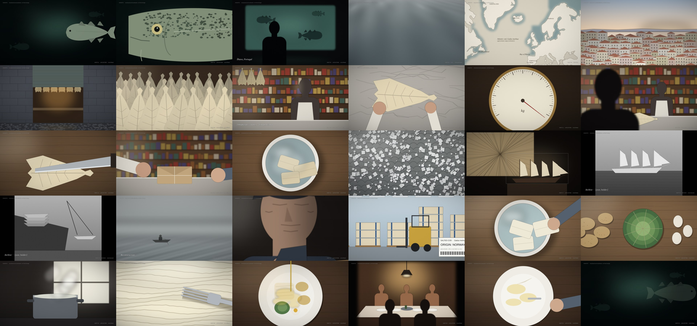

# cinematic-documentary-lab

Pre-production and previsualisation for two-minute cultural documentaries.

## Episode 1: *The Faithful Friend*

Portugal's most emblematic food, salt cod (*bacalhau*), is made from a fish that has never lived in Portuguese waters. The film follows one cod from a Lisbon grocer's counter to a family pot and asks how a cold-water stranger became the taste of home.



### Status

| Stage | State |
| --- | --- |
| Research, script, storyboard, AI prompts, shot list, edit plan, QC plan | Done: [docs/production-package.md](docs/production-package.md) |
| Animatic (timed storyboard film with scratch sound) | Done: [deliverables/](deliverables) |
| Location filming, archive licensing, AI shot generation | **Not done** |
| Final film | **Not made.** It cannot exist until the footage above does |

**The video in this repository is an animatic, not the finished documentary.** Every picture in it is a drawn storyboard panel, the narrator is a synthetic voice, and the music and ambience are synthesised placeholders. It exists to prove the script, the timings and the cut before money is spent on a shoot. [docs/animatic-notes.md](docs/animatic-notes.md) says exactly what is real, what is a placeholder and what is still needed.

### What is here

| Path | Contents |
| --- | --- |
| `docs/production-package.md` | Editorial concept, research dossier with sources, timecoded script, 30-shot storyboard, AI generation prompts, footage acquisition list, editing plan, quality control |
| `docs/animatic-notes.md` | How the animatic was made, its measured specifications, limitations, credits, and the path from here to a final film |
| `deliverables/the-faithful-friend_animatic_v1_2160p25.mp4` | Animatic master: 3840 × 2160, 25 fps, 120.00 s, stereo at −23 LUFS |
| `deliverables/the-faithful-friend_animatic_v1_1080p25.mp4` | 1080p viewing copy |
| `deliverables/the-faithful-friend_animatic_v1.en.srt` | English subtitles, delivered separately |
| `animatic/` | Source code that draws, animates, scores and assembles the animatic |

### Rebuild

```bash
pip install numpy pillow piper-tts
```

```bash
VOICE=/path/to/en_GB-alan-medium.onnx ./animatic/build.sh
```

The voice file comes from the [Piper voices collection](https://huggingface.co/rhasspy/piper-voices/tree/main/en/en_GB/alan/medium). The build needs `ffmpeg` and the Liberation fonts, and takes about ten minutes on four cores.

The cut is defined in one place, `animatic/timeline.py`: shot order and lengths, captions, dissolves and narration cues. Change it there and rebuild.
